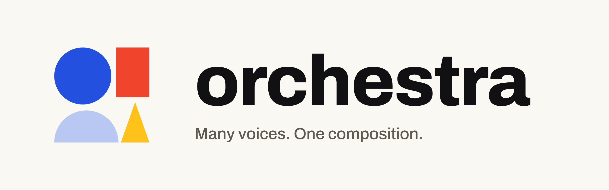

<p align="center">
  <picture>
    <source media="(prefers-color-scheme: dark)" srcset="assets/brand/readme-hero-dark.png">
    
  </picture>
</p>

<p align="center">
  <a href="https://code.claude.com/docs/en/plugins"></a>
  
  <a href="LICENSE"></a>
  <a href="https://oarthurbg.github.io/orchestra/"></a>
</p>

# orchestra

A Claude Code plugin for running one project with several Claude sessions at once: one **orchestrator** session that only coordinates, and one **workstream** session per feature, each taking its feature from spec to PR with its own worktree, isolated test data and subagents. It works for any kind of app: no database, server or Docker required.

It was built while developing an internal media-planning app, and packages the workflow that came out of it: spec first, two-stage and risk-proportional reviews, a third UI review from real screenshots, handoff notes and context clearing, isolated test data per workstream, and a ponytail mode and set of skills for every stage.

**See the whole stack on one page:** [docs/index.html](docs/index.html) (published at <https://oarthurbg.github.io/orchestra/>).

## What's inside

```
plugins/orchestra/
  agents/      explorer, planner, implementer, implementer-advanced, mechanic,
               spec-reviewer, quality-reviewer, screenshotter, verifier
  skills/      orchestrator (with stages.md: modes, skills and reviews per stage,
               and checklists.md: merge, release and hotfix)
               workstream, handoff-note, test-databases (test data recipes per data store,
               plus an optional, tested Postgres-in-Docker example)
  commands/    /orchestra:init, /orchestra:start-workstream, /orchestra:status,
               /orchestra:close-wave
  templates/   CLAUDE.md (project settings, owner authorizations), HANDOFF.md, lessons.md,
               handoff-note.md, githooks/pre-push (branch guard)
docs/index.html  the stack at a glance
docs/BRAND.md    mark, colors and type
assets/brand/    logo, plugin icon, README hero, social preview
```

| Agent | Model, effort | Ponytail | Job |
| --- | --- | --- | --- |
| explorer | Haiku, low | full | Read-only searches and summaries |
| planner | Opus, high | ultra | Spec to plan with `superpowers:writing-plans`, tasks tagged with agent and risk |
| implementer | Sonnet, medium | full (lite on UI) | One task, TDD, commit |
| implementer-advanced | Opus, high | full (ultra on infra) | Security, migrations, integrations, Docker |
| mechanic | Haiku, low | full | Docs, renames, formatting |
| spec-reviewer | Sonnet, medium | off | Does it match the spec, nothing missing or extra? Read-only |
| quality-reviewer | Opus, high | off | Real bugs, security, failure cases, with `ponytail:ponytail-review`. Read-only |
| screenshotter | Sonnet, low | full | Light and dark, wide and narrow, empty, loading and error states |
| verifier | Sonnet, low | full | Full verification before the PR, report only |

Every project-specific value (branches, commands, dev server, test data commands, how agents sign in for browser checks) lives in one "Project settings" block in the project's `CLAUDE.md`, which `/orchestra:init` writes.

## Install

In a Claude Code session:

```
/plugin marketplace add oarthurbg/orchestra
/plugin install orchestra@orchestra
```

Then install the plugins the workflow uses. This marketplace lists them, fetched from their own upstream repositories (nothing is copied here):

```
/plugin install superpowers@orchestra
/plugin install ponytail@orchestra
/plugin install impeccable@orchestra
/plugin install taste-skill@orchestra
/plugin install frontend-design@orchestra
/plugin install design@orchestra
/plugin install security-audit@orchestra
/plugin install playwright-cli@orchestra
```

Skip any you already have from another marketplace (for example `superpowers@claude-plugins-official`): two copies of one plugin load duplicate skills. From a shell, the same steps are `claude plugin marketplace add oarthurbg/orchestra` and `claude plugin install <name>@orchestra`.

`dataviz` (chart and dashboard design) is built into recent Claude Code versions, so there is nothing to install. If you already added `security-audit` or `playwright-cli` by hand to `~/.claude/skills`, skip their plugins. `playwright-cli` is only for apps with a web UI, and it also needs the CLI itself: `npm install -g @playwright/cli@latest`. `claude-security` is an optional deep scan of finished code before a release.

Then, in your project:

1. Run `/orchestra:init`. It looks at the project, proposes the "Project settings" (including test data commands that match your data store, or `none`), and scaffolds `CLAUDE.md` settings, `docs/HANDOFF.md` and `docs/workstreams/`.
2. In your main session, load the `orchestra:orchestrator` skill. Its "First session" steps confirm the settings and owner authorizations with you, write the first backlog and open the first workstreams with `/orchestra:start-workstream <name> <goal>`.
3. Ask "how is it going?" any time: the orchestrator answers with `/orchestra:status`, one table of every workstream plus what needs you.

## Requirements

- **Claude Code desktop app** (Code tab) for the session tools the workflow relies on: starting sessions, messaging between them, reading their context size, clearing and archiving them. In the plain CLI the roles and agents still work, but you start, brief, clear and archive sessions by hand.
- **Docker** only if you pick the optional Postgres-in-Docker test data example.
- **git** with worktrees, and the **GitHub CLI** (`gh`) for PRs.
- **Claude Code 2.1.309 or newer** for the band. Older versions were not tested.

## The band

orchestra draws a band above the prompt in every session. In an orchestra project the orchestrator's band shows the 5-hour and weekly plan limits, when the week runs out at the current pace, how many workstreams are running, and one row for each workstream that needs you: waiting on an answer, over 250k tokens of context, gone quiet (its report is more than 30 minutes old), or an `unregistered` row for a worktree session that is not in `.orchestra/workstreams.md`, so a forgotten worktree gets noticed. In the desktop app a row's name opens that session. In any session of the project, in the desktop app or the terminal, a `Liveview` button opens the local dashboard while it runs. A workstream session shows the same summary and its own row. In other projects the band shows the limits line only.

Each session writes its own report to `.orchestra/sessions/` (not versioned) after each turn; the band re-reads the folder every 20 seconds. Staying live costs no tokens.

**Keep-warm.** While one of a session's own subagents runs, the band sends a one-line request just before the prompt cache would expire, so the session does not pay to write its whole context to the cache again when the subagent returns. It runs in every project, not only orchestra ones, and covers background and foreground subagents and long tool calls. It never pings while the main thread is itself making requests, since those keep the cache warm. The summary line counts the pings (`warm 2x`). A cache read costs about 0.1x the input price; rewriting an expired cache costs 1.25x (5-minute cache) or 2x (1-hour cache). How cache reads count against plan limits is not published. Two settings, in the plugin's config menu:

- `cacheMinutes` (default 60): your cache lifetime. Use 5 for API keys and overage.
- `warmMaxHours` (default 2): stop keeping the cache warm for a subagent that has run this long. Pings stop once every running subagent is older than this.

A subagent's age counts from when the band first saw it running, so one that was already running when the session started gets the full limit.

If a ping finds the cache already gone, it is not counted as a ping, pings stop until the main thread makes its next request, and the band shows this once per session: `orchestra band: keep-warm missed the cache; set cacheMinutes lower (5 for API keys and overage)`.

The band shares its slot with other mods. ponytail's band stays as it is, with its own level switch. ponytail's level is one flag for every session (`~/.claude/.ponytail-active`): switching it in one session switches all of them, while each orchestra agent's per-stage mode stays in its own prompt.

## Recommended settings

- **Bypass permissions, per project.** With 4 to 6 sessions and their subagents, approval prompts would stall the work all day, so orchestra is meant to run with the permission mode set to bypass, in the project only: the desktop app's permission-mode picker per session, or `"permissions": { "defaultMode": "bypassPermissions" }` in the project's `.claude/settings.local.json` (not in your global settings). Claude Code then never stops to ask, so these take over as the gates:
  - **Owner authorizations** in the project's `CLAUDE.md`: for merges, releases, hotfixes, clears, archiving and new sessions, `ask`, `tell` or `auto`. They start at `ask`. Anything that needs admin rights, deletes data or branches, or touches credentials, money or production data is always `ask`, for every session and subagent.
  - **The branch guard**, which `/orchestra:init` offers to install: a `pre-push` hook that refuses direct pushes to your integration and production branches. It is a local net (per clone, and skipped by `--no-verify`), so also turn on branch protection on GitHub for both branches.

  Use bypass permissions only in repositories you trust, keep real credentials out of the repository, and don't run it on a machine where an agent could reach production data you can't afford to lose.

- **Auto-compact safety net at 600k tokens.** In `~/.claude/settings.json`:

  ```json
  { "autoCompactWindow": 600000 }
  ```

  It applies to new or restarted sessions. The real rule is earlier: a workstream above 250k tokens at the end of a wave writes its handoff note and gets cleared at a natural stop. The 600k net catches the case where nobody checked in time.
- **Auto-archive on PR close: off** (desktop app setting). Archiving a session kills its process and its background agents, and unarchiving does not bring them back. Workstream sessions open spec and plan PRs and keep working after those merge, so auto-archive would stop them mid-workstream. The orchestrator archives finished sessions itself, after checking nothing is running.
- **Ponytail modes per session.** Every session starts in full. The orchestrator stays in full. The workstream session switches its own mode per stage and states it in every subagent briefing: brainstorm and mockups off, spec lite, plan ultra, backend full, UI lite, infrastructure ultra, reviews off. The full table is in [`stages.md`](plugins/orchestra/skills/orchestrator/stages.md).

## Credits

orchestra only decides where each of these enters the flow. All credit for the skills themselves goes to their authors:

- [superpowers](https://github.com/obra/superpowers) by Jesse Vincent (obra): brainstorming, plans, subagent-driven development, TDD, debugging, code review. MIT.
- [ponytail](https://github.com/DietrichGebert/ponytail) by Dietrich Gebert: the lite, full and ultra modes, review, debt and audit. MIT.
- [impeccable](https://github.com/pbakaus/impeccable) by Paul Bakaus: UI implementation craft, the detector and the finish reviewer. Apache-2.0.
- [taste-skill](https://github.com/Leonxlnx/taste-skill) by leonxlnx: art direction for mockups. MIT.
- [frontend-design](https://github.com/anthropics/claude-plugins-official/tree/main/plugins/frontend-design) by Anthropic: visual direction for mockups. Apache-2.0.
- [design](https://github.com/anthropics/knowledge-work-plugins/tree/main/design) by Anthropic (knowledge-work plugins): design critique and accessibility review. Apache-2.0.
- [security-audit](https://github.com/cloudflare/security-audit-skill) by Cloudflare: multi-phase security audits with verified findings. MIT.
- [playwright-cli](https://github.com/microsoft/playwright-cli) by Microsoft: browser checks and screenshots from the command line. Apache-2.0.

## Design

The mark is a small Bauhaus composition. Kandinsky and Itten paired the basic shapes with the primary colors: the circle is blue, the square red, the triangle yellow. Here a blue circle rests on a half circle, the pause the others play over, next to a red block and a yellow triangle: separate voices, one composition. The four ponytail modes on the docs page use the same four shapes. Brand files and rules are in [`docs/BRAND.md`](docs/BRAND.md).

## License

orchestra's own files are under the [Apache License 2.0](LICENSE); keep the [`NOTICE`](NOTICE) file when you redistribute them. The orchestra name and logo are not part of that license: you may use them unmodified to refer to this project, but not to brand your own fork or product (see [`docs/BRAND.md`](docs/BRAND.md)). The third-party plugins above are not part of this repository; each keeps its own license and is fetched from its own repository when you install it.
