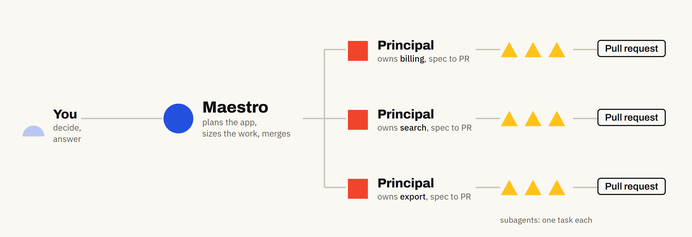
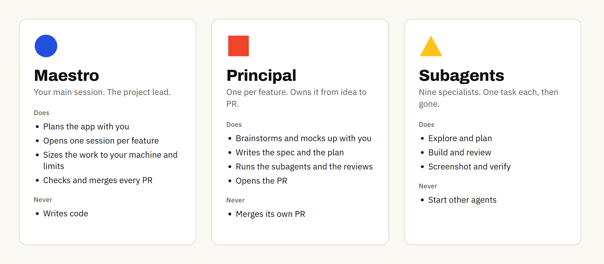
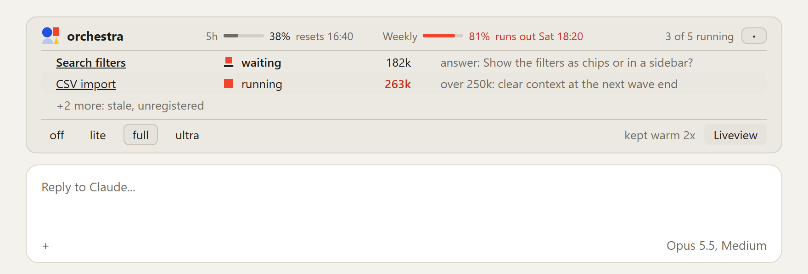
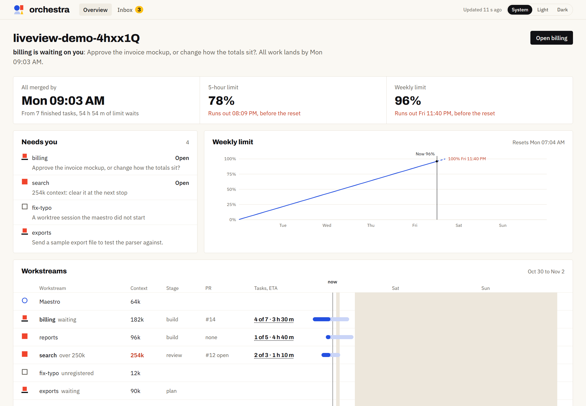
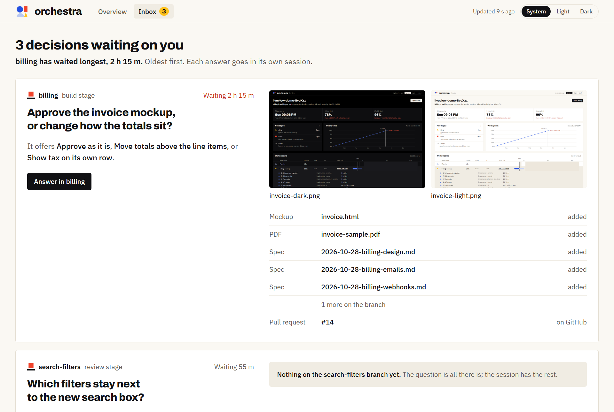
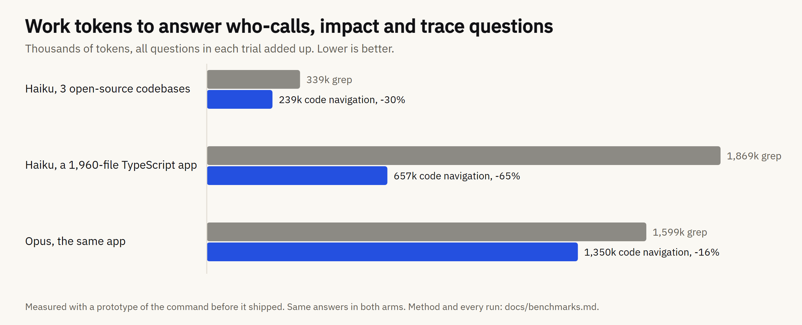
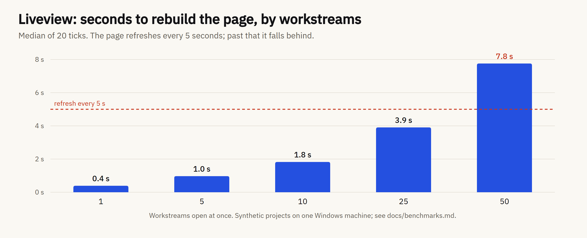

<p align="center">
  <picture>
    <source media="(prefers-color-scheme: dark)" srcset="assets/brand/readme-hero-dark.png">
    
  </picture>
</p>

<p align="center">
  <a href="https://code.claude.com/docs/en/plugins"></a>
  
  <a href="LICENSE"></a>
  <a href="https://oarthurbg.github.io/orchestra/"></a>
</p>

# orchestra

**Run one project with many Claude Code sessions at once.**

One session plans. One session per feature builds. You answer questions.

A Claude Code plugin, built while developing an internal media-planning app. It works for any kind of app: no database, server or Docker required.

## How it works

<p align="center">
  <picture>
    <source media="(prefers-color-scheme: dark)" srcset="assets/readme/how-it-works-dark.png">
    
  </picture>
</p>

1. **You and the maestro plan the app.** It splits the work into features and opens one session for each, as many at once as your machine and your plan limits allow.
2. **Each principal builds one feature** in its own worktree: it mocks up and specs with you, then sends subagents to plan, build, review and test.
3. **Every feature ends as a pull request.** The maestro checks it and merges it. When a session needs a decision, it asks you.

## Who does what

<p align="center">
  <picture>
    <source media="(prefers-color-scheme: dark)" srcset="assets/readme/roles-dark.png">
    
  </picture>
</p>

The shape is the role everywhere orchestra draws a session. How it is drawn is the state: **solid** running, **outlined** idle, **over a heavy rule** waiting on you, **grey** stale. The rules are in [`BRAND.md`](docs/BRAND.md#symbols), and the nine subagents are in [Agents](docs/agents.md).

## See it

**The band** sits above the prompt in every session: your plan limits, and each workstream that needs you, most urgent first. [More about the band](docs/band.md).

<p align="center">
  <picture>
    <source media="(prefers-color-scheme: dark)" srcset="docs/images/band-compact-dark.png">
    
  </picture>
</p>

> **Note:** the `off lite full ultra` buttons at the bottom of the band switch [ponytail](https://github.com/DietrichGebert/ponytail)'s level for every session. They show only when ponytail is installed and its own band is hidden with `/ponytail band`.

**The liveview** is a local page with every workstream's progress, ETA and timeline. It runs on your machine and uses no tokens. [More about the liveview](docs/liveview.md).

<p align="center">
  <picture>
    <source media="(prefers-color-scheme: dark)" srcset="assets/readme/liveview-dark.png">
    
  </picture>
</p>

**The inbox** lists every question waiting on you, oldest first, with the mockups and specs you need to answer it.

<p align="center">
  <picture>
    <source media="(prefers-color-scheme: dark)" srcset="assets/readme/inbox-dark.png">
    
  </picture>
</p>

## Features

<table>
  <tr><td></td><td><b>Parallel workstreams.</b> One session and one worktree per feature, all at once. <a href="docs/stages.md">Read more</a></td></tr>
  <tr><td></td><td><b>Nine subagents.</b> Each with its own model: Opus for judgment, cheaper for chores. <a href="docs/agents.md">Read more</a></td></tr>
  <tr><td></td><td><b>The right skills at every stage.</b> Brainstorm, spec, plan, build, review, PR. <a href="docs/stages.md">Read more</a></td></tr>
  <tr><td><picture><source media="(prefers-color-scheme: dark)" srcset="assets/readme/features/reviews-dark.svg"></picture></td><td><b>Reviews before every merge.</b> Spec, quality and finish reviews, then the whole branch. <a href="docs/stages.md#reviews">Read more</a></td></tr>
  <tr><td></td><td><b>The band.</b> Plan limits and who needs you, above every prompt. <a href="docs/band.md">Read more</a></td></tr>
  <tr><td><picture><source media="(prefers-color-scheme: dark)" srcset="assets/readme/features/liveview-dark.svg"></picture></td><td><b>The liveview and inbox.</b> Progress, ETAs and your questions. No tokens. <a href="docs/liveview.md">Read more</a></td></tr>
  <tr><td></td><td><b>Code navigation.</b> A language server instead of grep. Fewer tokens. <a href="docs/setup.md#code-navigation">Read more</a></td></tr>
  <tr><td></td><td><b>Context kept small.</b> Handoff and clear past 250k; nothing lost on a compact. <a href="docs/setup.md#recommended-settings">Read more</a></td></tr>
  <tr><td></td><td><b>Keep-warm.</b> The prompt cache stays warm while subagents run. <a href="docs/band.md#keep-warm">Read more</a></td></tr>
  <tr><td></td><td><b>Guardrails for bypass mode.</b> Owner authorizations and a branch guard. <a href="docs/setup.md#recommended-settings">Read more</a></td></tr>
</table>

## Does it help?

Measured, not estimated. Every number comes from a script in [`bench/`](bench) and is explained in [Benchmarks](docs/benchmarks.md).

**Code navigation saves tokens.** Explorers find who calls what with a language server instead of grep, and reach the same answers with fewer tokens. The saving is largest for small models on big codebases.

<p align="center">
  <picture>
    <source media="(prefers-color-scheme: dark)" srcset="assets/readme/bench-tokens-dark.png">
    
  </picture>
</p>

**The liveview keeps up with 50 workstreams,** the most measured. One rebuild then takes 0.5 s of its 5-second refresh.

<p align="center">
  <picture>
    <source media="(prefers-color-scheme: dark)" srcset="assets/readme/bench-liveview-dark.png">
    
  </picture>
</p>

## Install

One command installs orchestra and the plugins it works with, and skips any you already have. It needs Claude Code and Node 18 or newer, on macOS, Linux or Windows:

```bash
npx orchestra-install
```

Then, in your project, run `/orchestra:init` and load the `orchestra:maestro` skill in your main session. It walks you through the rest. `/orchestra:help` lists the commands and says which one to run next; [Commands](docs/commands.md) explains each one.

What the script runs, how to install by hand, updates, orchestra's settings, requirements and recommended settings are in [Setup](docs/setup.md).

## Learn more

- [Setup](docs/setup.md): install, update, requirements and recommended settings.
- [Agents](docs/agents.md): the nine subagents, their models and their jobs.
- [Stages, modes and skills](docs/stages.md): what runs at each stage, and why.
- [The band](docs/band.md) and [the liveview](docs/liveview.md).
- [Benchmarks](docs/benchmarks.md): how every number above was measured.
- [The whole stack on one page](https://oarthurbg.github.io/orchestra/).
- [Brand](docs/BRAND.md): the mark, the colors and the symbols.

orchestra builds on [superpowers](https://github.com/obra/superpowers), [ponytail](https://github.com/DietrichGebert/ponytail), [impeccable](https://github.com/pbakaus/impeccable) and other plugins by their authors. Full credits are in [Setup](docs/setup.md#credits).

## License

orchestra's own files are under the [Apache License 2.0](LICENSE); keep the [`NOTICE`](NOTICE) file when you redistribute them. The orchestra name and logo are not part of that license: you may use them unmodified to refer to this project, but not to brand your own fork or product (see [`docs/BRAND.md`](docs/BRAND.md)). The third-party plugins are not part of this repository; each keeps its own license and is fetched from its own repository when you install it.
