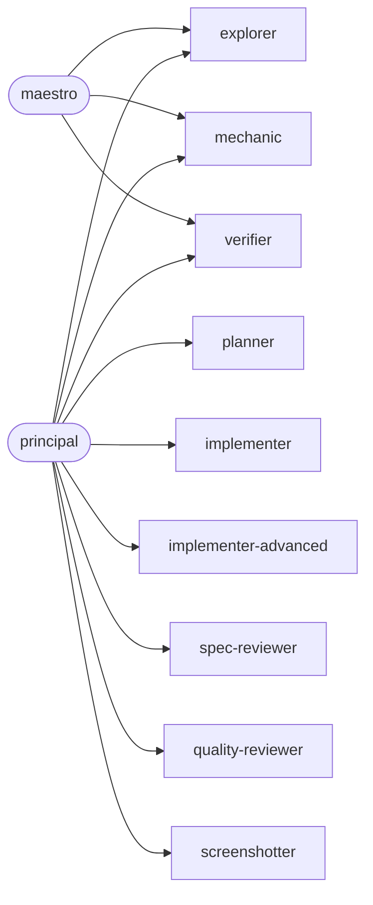

# The nine agents

orchestra ships nine subagents. Each one does a single job, has its model and effort fixed in its own file (`plugins/orchestra/agents/<name>.md`), and starts in the ponytail mode its stage calls for. A subagent never spawns other agents: the session that dispatched it gives it its task, mode and skills in the briefing.

[README](../README.md) · **Agents** · [Stages, modes and skills](stages.md) · [The band](band.md)

## At a glance

| Agent | Model, effort | Ponytail | Edits files | Dispatched by |
| --- | --- | --- | --- | --- |
| [explorer](#explorer) | Haiku, low | full | no | maestro, principal |
| [planner](#planner) | Opus, high | ultra | the plan only | principal |
| [implementer](#implementer) | Sonnet, medium | full, lite on UI | yes | principal |
| [implementer-advanced](#implementer-advanced) | Opus, high | full, ultra on infrastructure | yes | principal |
| [mechanic](#mechanic) | Haiku, low | full | yes | maestro, principal |
| [spec-reviewer](#spec-reviewer) | Sonnet, medium | off | no | principal |
| [quality-reviewer](#quality-reviewer) | Opus, high | off | no | principal |
| [screenshotter](#screenshotter) | Sonnet, low | full | no | principal |
| [verifier](#verifier) | Sonnet, low | full | no | maestro, principal |

## Who dispatches whom

The **maestro** plans the app, sizes the work to the machine and the token limits, and coordinates, but never builds, so its own subagents never write code: `explorer` looks things up so it never reads large files itself, `mechanic` updates docs after merges through a docs PR, and `verifier` checks the integration branch after a merge.

A **principal** leads one workstream from spec to PR and uses all nine: it plans with `planner`, builds with the implementers and `mechanic`, reviews with the two reviewers and `screenshotter`, and runs `verifier` before the PR.

## The model follows the judgment

The model and effort follow how much judgment a job needs and how costly a mistake is:

- **Haiku, low** for jobs with no decisions: finding where something lives (`explorer`) and doing exactly what the prompt says (`mechanic`). Both stop and report the moment a decision appears.
- **Sonnet** for jobs that follow a clear script: implementing one well-specified task, checking a build against its spec, running commands, taking screenshots. Effort is medium where reading code is the job (`implementer`, `spec-reviewer`) and low where running commands is the job (`verifier`, `screenshotter`).
- **Opus, high** where a miss is expensive: the plan every task comes from (`planner`), security, migrations and integrations (`implementer-advanced`), and the review that hunts for real bugs (`quality-reviewer`).

## Shared rules

Every agent that commits follows the same rules, because several of them can work in worktrees of one repository at once:

- `git add <path>` only, never `git add -A`, and a look at `git diff --cached --stat` before the commit;
- never `git stash`, because the stash list is shared across worktrees and one agent could apply another's stash;
- never commit on the integration or production branch;
- tests that need data run only against the workstream's isolated test data, never real or dev data;
- credentials never enter the repository or the logs;
- steps marked 👤 belong to the owner and are never run by an agent.

The commands, branches, test data and dev server come from the "Project settings" block in the project's `CLAUDE.md`, which `/orchestra:init` writes. When a skill says something different from the project's `docs/HANDOFF.md` (worktrees, merge, PR target), the HANDOFF wins.

---

## explorer

**Haiku, low** · ponytail **full** · read-only · dispatched by the maestro and principals

**Job.** Searches and summarizes the repository: where X lives, who calls Y, what a large file does. It answers with `file:line` for every finding, quotes code only when the code is the answer, and says where it looked when it finds nothing.

**Why it exists.** Reading whole files fills a session's context. The maestro and principals send `explorer` to read for them and keep only the conclusion. It runs nothing that changes state and never reads credentials, `.env` files or paths the project marks as confidential.

## planner

**Opus, high** · ponytail **ultra** · writes only the plan · dispatched by principals

**Job.** Turns one workstream's approved spec into an implementation plan with `superpowers:writing-plans`. Each task fits a subagent with a 100k to 200k token window and is self-contained, with an **Interfaces** block of exact names, signatures and paths. Every task is tagged with the agent that should build it (`implementer`, `implementer-advanced` or `mechanic`) and its risk (`mechanical`, `normal`, `sensitive` or `ui`). The principal picks the reviews from that risk tag.

**Why ultra.** The spec rules everything. Ultra cuts from the plan whatever the spec does not ask for, and never what it does. If the spec is wrong, incomplete, or overlaps another workstream, the planner stops and reports instead of planning over it: the fix goes into the spec first.

Before planning it reads the HANDOFF, the spec, earlier plans that touch the same files and `docs/lessons.md`, and carries the relevant lessons into the tasks they affect.

## implementer

**Sonnet, medium** · ponytail **full**, **lite** on UI tasks · edits and commits · dispatched by principals

**Job.** Implements exactly one normal task from a plan (screens, routes, CRUD, server handlers, tests, scripts) with TDD: write the test, watch it fail, implement the minimum, watch it pass, then commit.

**Why lite on UI.** On a UI task the implementer loads `impeccable:impeccable` in Operate mode and reads its craft floor before any edit. The approved mockup rules, and impeccable decides what the mockup does not show: hover, focus, loading, empty and narrow screens. Full mode would cut exactly those states, so UI work runs in lite.

It uses the **Interfaces** block exactly. If a task contradicts the spec it stops and reports instead of inventing. When the project has a dev server, it opens the screen it touched in light and dark themes and reports what it saw.

## implementer-advanced

**Opus, high** · ponytail **full**, **ultra** on Docker, servers, CI, scripts and dependencies · edits and commits · dispatched by principals

**Job.** Implements one hard task: security (sign-in, sessions, roles, 2FA, tokens), data migrations and schema changes, external API integrations, Docker and deployment.

**Why Opus.** Mistakes here cost data, access or money. Before writing security, migration or integration code it checks the official documentation of the framework, ORM, auth library or API instead of trusting memory. It tests the failure cases the task names (API down, expired token, permission denied, partial migration). It never deletes existing data without an explicit 👤 step.

**Why ultra on infrastructure.** On servers, CI, scripts and dependencies every extra line is something to run, secure and keep up to date, so ultra keeps the change as small as possible.

## mechanic

**Haiku, low** · ponytail **full** · edits and commits · dispatched by the maestro and principals

**Job.** One mechanical task, exactly as asked: update documentation, the HANDOFF or handoff notes, rename, format or move files.

**Why Haiku.** It makes no decisions. If the task needs one (choosing a name, changing behavior, interpreting the spec), it stops and reports. The maestro uses it for docs updates after merges, always through a docs PR.

## spec-reviewer

**Sonnet, medium** · ponytail **off** · read-only · dispatched by principals

**Job.** The first review of a task or PR: was it built as the spec and the plan say? It checks that every spec item exists, that the **Interfaces** match exactly, that nothing beyond the request was added, that the requested tests exist and pass (it runs them itself), and that the commits follow the project's rules. It answers `APPROVED` or `REJECTED` with the list of mismatches, and says separately when a mismatch looks like a spec error rather than a code error.

**Why off.** A review has to report every mismatch it finds, so it ignores any injected ponytail mode and answers only in its review format. Style suggestions are not its job; they belong to the quality reviewer.

## quality-reviewer

**Opus, high** · ponytail **off** · read-only · dispatched by principals

**Job.** The second review: real bugs, security holes, behavior on failure, tests that don't test what they claim, and maintenance problems, in that order. It uses the `ponytail:ponytail-review` method (correct, secure, holds under load, tested, fast, every line earns its place) without the injected mode. It flags only what it can justify with a concrete failure scenario and answers `APPROVED` or `CHANGES NEEDED`, each item with severity, `file:line`, the scenario that breaks it and a suggested fix. Low-severity items do not block.

**Why Opus.** Finding a race condition, a rounding error in money math or a route that skips the session check is the review that most needs judgment.

## screenshotter

**Sonnet, low** · ponytail **full** · read-only · dispatched by principals

**Job.** Runs the app from the workstream's integration worktree and captures every screen the prompt names: light and dark themes, wide and narrow widths, and the empty, loading and error states. The screenshots feed `impeccable:impeccable-finish-reviewer`, the third review for UI tasks, which compares them with the approved mockup.

Only for apps with a web UI, where "Dev server" and "Browser checks" in "Project settings" are not `none`. It signs in only with a saved session, never types a password, and never writes to real or dev data.

## verifier

**Sonnet, low** · ponytail **full** · read-only · dispatched by the maestro and principals

**Job.** Runs a workstream's full verification and reports: code generation, typecheck, lint, unit tests, integration tests against isolated test data, tests in other languages, then the build. For each command it reports pass or fail with the output that matters. It fixes nothing and suggests no fixes.

**Why it is separate.** A principal runs it before every PR so the claim "it passes" comes with real command output. The maestro runs it on the integration branch after a merge.
