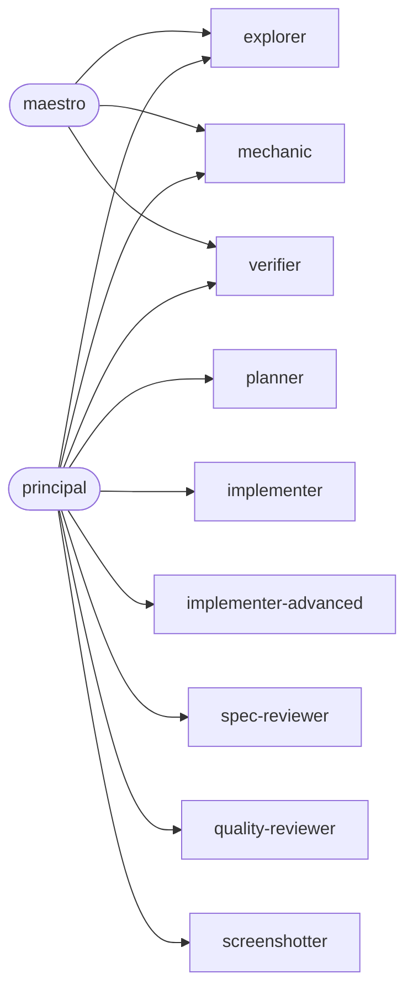

# The nine agents

orchestra ships nine subagents. Each does one job, with its model, effort and ponytail mode fixed in its own file (`plugins/orchestra/agents/<name>.md`). The session that dispatches it gives it the task and skills in the briefing.

[README](../README.md) · [Setup](setup.md) · [Commands](commands.md) · **Agents** · [Stages, modes and skills](stages.md) · [The band](band.md) · [The liveview](liveview.md) · [Benchmarks](benchmarks.md)

## At a glance

| Agent | Model, effort | Ponytail | Edits files | Dispatched by |
| --- | --- | --- | --- | --- |
| [explorer](#explorer) | Haiku, low | full | no | maestro, principal |
| [planner](#planner) | Opus, high | ultra | the plan only | principal |
| [implementer](#implementer) | Sonnet, medium | full, lite on UI | yes | principal |
| [implementer-advanced](#implementer-advanced) | Opus, high | full, ultra on infrastructure | yes | principal |
| [mechanic](#mechanic) | Haiku, low | full | yes | maestro, principal |
| [spec-reviewer](#spec-reviewer) | Opus, medium | off | no | principal |
| [quality-reviewer](#quality-reviewer) | Opus, high (xhigh on sensitive tasks) | off | no | principal |
| [screenshotter](#screenshotter) | Sonnet, low | full | no | principal |
| [verifier](#verifier) | Sonnet, low | full | no | maestro, principal |

The **maestro** plans the app and coordinates the workstreams but never builds. It uses three agents: `explorer` to read for it, `mechanic` to update docs after merges (through a docs PR), and `verifier` to check the integration branch after a merge.

A **principal** leads one workstream from spec to PR and uses all nine.

**Why these models.** The model follows how much judgment the job needs and how costly a mistake is:

- **Haiku** for jobs with no decisions (`explorer`, `mechanic`). Both stop and report when a decision appears.
- **Sonnet** for jobs that follow a clear script: one well-specified task, running commands, taking screenshots.
- **Opus** where a miss is expensive: the plan, security and migrations, both reviews, and the bug hunt. In a test of 10 reviewers on one correction, Opus found more of the 13 serious problems than Sonnet at every effort from medium to xhigh (9 against 2 at medium); Akita's benchmark saw Sonnet 5.5 miss a planted bug that Opus caught.

## Shared rules

Several agents can work in worktrees of one repository at once, so every agent that commits:

- stages with `git add <path>` only, never `git add -A`, and checks `git diff --cached --stat` first;
- never uses `git stash` (the stash list is shared across worktrees);
- never commits on the integration or production branch;
- runs data tests only against the workstream's isolated test data;
- keeps credentials out of the repository and the logs;
- never runs a step marked 👤 (those belong to the owner).

Commands, branches, test data and the dev server come from the "Project settings" block in the project's `CLAUDE.md`, written by `/orchestra:init`. If a skill disagrees with the project's `docs/HANDOFF.md`, the HANDOFF wins.

---

## explorer

Searches and summarizes the repository: where X lives, who calls Y, what a large file does. Answers with `file:line` for each finding. For who-calls and impact questions in TypeScript, JavaScript or Python it uses a language server, with grep as the fallback.

It exists so the maestro and principals never read whole files and keep only the conclusion. It changes nothing and never reads credentials, `.env` files or confidential paths.

## planner

Turns an approved spec into a plan with `superpowers:writing-plans`. Each task is self-contained, fits one subagent, and has an **Interfaces** block of exact names, signatures and paths. Each task is tagged with the agent that builds it and a risk (`mechanical`, `normal`, `sensitive` or `ui`) that picks its [reviews](stages.md#reviews).

It reads the HANDOFF, the spec, earlier plans on the same files and `docs/lessons.md` first. Ultra cuts whatever the spec does not ask for, never what it does. If the spec is wrong, incomplete or overlaps another workstream, it stops and reports: the spec gets fixed first.

## implementer

Builds one normal task (screens, routes, CRUD, handlers, tests, scripts) with TDD: failing test, minimum code, passing test, commit. It uses the **Interfaces** block exactly and stops if the task contradicts the spec. When a task touches a screen and the project has browser checks, it opens the screen in light and dark themes and reports what it saw.

On UI tasks it runs in lite and loads `impeccable:impeccable` in Operate mode. The approved mockup rules; impeccable covers what the mockup does not show (hover, focus, loading, empty, narrow screens). Full mode would cut those states.

## implementer-advanced

Builds one hard task: security (sign-in, sessions, roles, 2FA, tokens), migrations and schema changes, external API integrations, Docker and deployment. Mistakes here cost data, access or money, so it checks the official documentation instead of trusting memory, tests the failure cases the task names, and never deletes existing data without a 👤 step.

On servers, CI, scripts and dependencies it runs in ultra: every extra line there is something to run, secure and keep up to date.

## mechanic

One mechanical task, exactly as asked: docs, the HANDOFF, handoff notes, renames, formatting, moving files. If the task needs a decision (a name, a behavior change, reading the spec), it stops and reports.

## spec-reviewer

The first review: was it built as the spec and plan say? It checks every spec item exists, the **Interfaces** match, nothing extra was added, the requested tests exist and pass (it runs them), and the commits follow the rules. Answers `APPROVED` or `REJECTED` with the mismatches, and flags the ones that look like spec errors. Style is not its job.

## quality-reviewer

The second review: real bugs, security holes, behavior on failure, tests that don't test what they claim, then maintenance problems. It uses the `ponytail:ponytail-review` method and flags only what it can back with a concrete failure scenario. Answers `APPROVED` or `CHANGES NEEDED`, each item with severity, `file:line`, the scenario and a fix. Low-severity items do not block.

## screenshotter

Runs the app from the workstream's integration worktree and captures the screens the prompt names: light and dark, wide and narrow, empty, loading and error states. The screenshots feed `impeccable:impeccable-finish-reviewer`, the third review for UI tasks. Only for web apps whose "Dev server" and "Browser checks" are not `none`. It signs in only with a saved session, never types a password, and never writes to real or dev data.

## verifier

Runs the full verification in order (code generation, typecheck, lint, unit tests, integration tests on isolated test data, tests in other languages, build) and reports pass or fail with the output that matters. It fixes nothing and suggests no fixes. A principal runs it before every PR, so "it passes" comes with real output; the maestro runs it after a merge. It runs only in a clean worktree, never the main checkout, where stray build output and broken links make test runners fail tests that pass.
