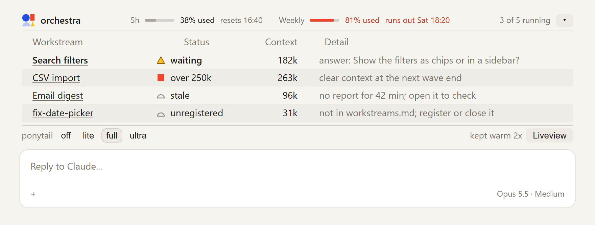
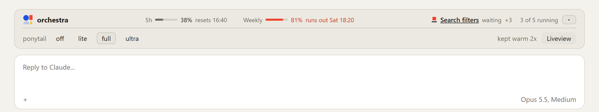

# The band

orchestra draws a band above the prompt in every Claude Code session. In the maestro's session it is the place to see what needs you: plan limits at the top, one row per workstream that needs attention, and the keep-warm count and the Liveview button at the bottom. Staying live costs no tokens.

[README](../README.md) · [Setup](setup.md) · [Commands](commands.md) · [Agents](agents.md) · [Stages, modes and skills](stages.md) · **The band** · [The liveview](liveview.md) · [Benchmarks](benchmarks.md)

  <picture>
    <source media="(prefers-color-scheme: dark)" srcset="images/band-compact-dark.png">
    
  </picture>
   Illustration: the band rebuilt from its source with sample sessions. Compact, as it opens.

  <picture>
    <source media="(prefers-color-scheme: dark)" srcset="images/band-open-dark.png">
    
  </picture>
   Illustration: the same band opened with the arrow, showing every row.

## Header

- **The orchestra mark and name.**
- **5h** and **Weekly**: the plan limits, each with a bar, the percentage used and the reset time. When the week will run out before it resets, the weekly limit turns red and says when (`runs out Sat 18:20`). While the [liveview](liveview.md) runs, that time comes from the work still planned: each workstream's remaining tasks at their estimated length, burning at the last day's pace, so a plan that ends before the week is spent shows no run-out. Without the liveview, or with no plan, the band projects the week's average pace so far. In a narrow window, as in a split view, the line keeps the percentages and the run-out time and drops the reset times.
- **`3 of 5 running`**: how many workstreams are running, out of how many are registered.
- **The arrow** steps through every row, the two most urgent, then none (it points inward, `◂`, while collapsed), and the band remembers your choice. With two rows or fewer it only collapses the band and opens it again.
- **Collapsed**, the band keeps its header and footer. The header names the most urgent workstream with its square and status, opens its session when clicked, and counts the others (`+3`).

  <picture>
    <source media="(prefers-color-scheme: dark)" srcset="images/band-collapsed-dark.png">
    
  </picture>
   Illustration: the band collapsed with the arrow.

## Rows

One row per workstream that needs you, most urgent first. Every row is a principal's session, so its symbol is the vermilion square, drawn to show its state (see [Symbols](BRAND.md#symbols)):

| Square | Status | When | Detail |
| --- | --- | --- | --- |
| Over a heavy rule | `waiting` | The session asked a question and is waiting on the owner | `answer:` and the question it asked |
| Solid or outlined, context in bold red | `running` or `idle` | Its context passed 250k tokens | `over 250k: clear context at the next wave end` |
| Grey outline | `stale` | Its report is more than 30 minutes old | `no report for 42 min; open it to check` |
| Grey outline | `unregistered` | A worktree session that is not in `.orchestra/workstreams.md` | `not in workstreams.md; register or close it` |

Columns: workstream (the session's title), status, context size and detail. A `waiting` row is bold. In the desktop app every cell of a row opens that session. The terminal draws the square as `■` or `□`, underlined while waiting.

The band shows two rows and a count of the rest (`+2 more: stale, unregistered`). With nothing due it says `Nothing needs you.`, and before the first workstream it says `No workstreams yet. Start one with /orchestra:start-workstream.`

The `unregistered` row is there so a forgotten worktree gets noticed: a session working in a worktree that nobody registered is work the maestro doesn't know about.

## Footer

The footer shows only when it has something to show:

- **ponytail's level switch**: the buttons `off lite full ultra`, the current one outlined, with no label beside them. They show when ponytail is installed and you hid its own band with `/ponytail band`. A press runs the same `/ponytail` command you would type. ponytail's level is one flag for every session, so switching it in one session switches all of them.
- **`kept warm 2x`**: how many keep-warm pings this session sent (see below).
- **`Liveview`**: opens the local dashboard while it runs. The dashboard writes `.orchestra/liveview.json` with its local URL, and the button shows only for a `localhost` or `127.0.0.1` address.

## Updates

When a newer orchestra is out, the band adds a line above the footer: `orchestra 1.3.2 is out`, with three buttons.

- **Changelog** opens [CHANGELOG.md](../CHANGELOG.md) on GitHub.
- **Update** runs `claude plugin marketplace update orchestra` and `claude plugin update orchestra@orchestra`, then says `Updated to 1.3.2. Run /reload-plugins to load it.` Each session runs the old version until you run `/reload-plugins` in it or start a new one. If a command fails, a toast gives the command to run yourself.
- **Later** hides the line for that version in every session. The next version shows it again.

The band reads the version on GitHub's main branch when a session starts and every 6 hours. It never updates by itself, and when GitHub can't be reached it says nothing. A copy of the plugin loaded from a mods folder for development is never offered an update.

## In other sessions

- A **principal's** band shows the limits and its own row: waiting, over 250k, running or idle, with its current stage.
- In a project without orchestra, the band shows the limits only, plus the keep-warm count when it has pinged.
- The band shares its slot with other mods and draws theirs beneath it.

## How it stays live

Each session writes a small report to `.orchestra/sessions/<session>.json` after each turn: its role, workstream, branch, state, stage, context size, plan limits and keep-warm count. The folder is not versioned. The band watches that folder, `.orchestra/workstreams.md` and `liveview.json`, and redraws within seconds of a change. A 5-second check covers anything the watch misses, and a view that didn't change is not redrawn. None of this calls the model, so staying live costs no tokens.

## Keep-warm

While one of a session's own subagents runs, the main thread makes no requests, and its prompt cache can expire. When the subagent returns, the session would then pay to write its whole context to the cache again. The band prevents that by sending a one-line request (`Reply with: ok`) just before the cache would expire.

- It runs in every project, not only orchestra ones, and covers background and foreground subagents and long tool calls.
- It never pings while the main thread is making requests itself, since those keep the cache warm.
- A cache read costs about 0.1x the input price; rewriting an expired cache costs 1.25x (5-minute cache) or 2x (1-hour cache). How cache reads count against plan limits is not published.

Settings (how to change them: [orchestra's settings](setup.md#orchestras-settings)):

| Setting | Default | Meaning |
| --- | --- | --- |
| `cacheMinutes` | 60 | Your cache lifetime. Use 5 for API keys and overage. |
| `liveviewTailnet` | off | Start the liveview on your Tailscale network too, to open it on your phone. See [The liveview](liveview.md#on-your-phone). |
| `warmMaxHours` | 2 | Stop keeping the cache warm for a subagent that has run this long. Pings stop once every running subagent is older than this. |

A subagent's age counts from when the band first saw it running, so one that was already running when the session started gets the full limit.

If a ping finds the cache already gone, it isn't counted, pings stop until the main thread makes its next request, and the band says so once per session: `orchestra band: keep-warm missed the cache; set cacheMinutes lower (5 for API keys and overage)`.

## Requirements

Claude Code 2.1.309 or newer; older versions were not tested. In the desktop app the band draws shapes, bars and clickable rows. In the terminal it draws glyphs instead, with no bars, and rows don't open sessions.

The design is in the [band spec](superpowers/specs/2026-10-30-band-mod-design.md).
