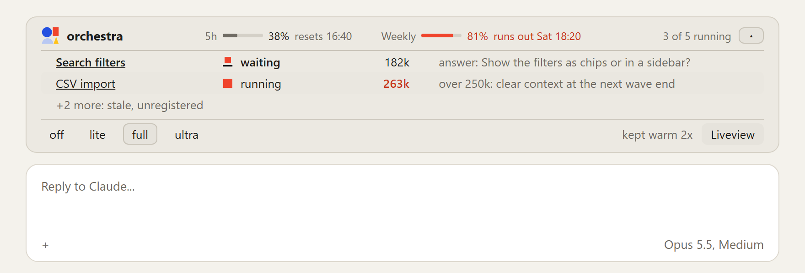
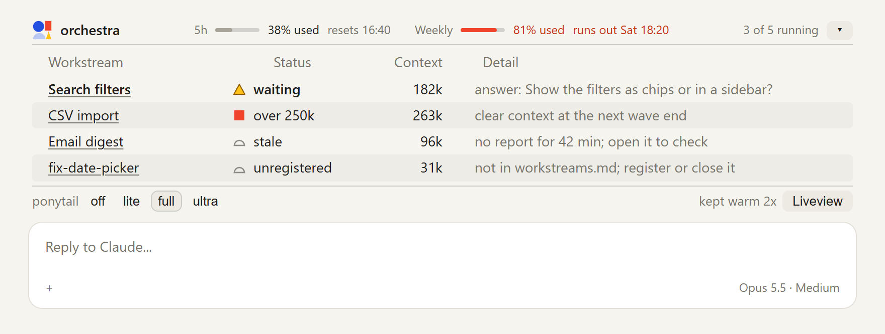
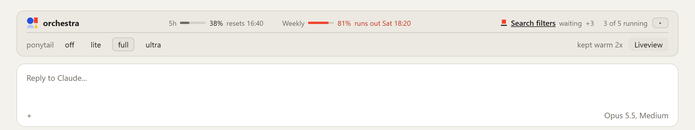

# The band

orchestra draws a band above the prompt in every Claude Code session. In the maestro's session it shows what needs you: plan limits at the top, one row per workstream that needs attention, and a footer with the keep-warm count and the Liveview button. It uses no tokens.

[README](../README.md) · [Setup](setup.md) · [Commands](commands.md) · [Agents](agents.md) · [Stages, modes and skills](stages.md) · [Memory and handoff](memory.md) · **The band** · [The liveview](liveview.md) · [Benchmarks](benchmarks.md)

  <picture>
    <source media="(prefers-color-scheme: dark)" srcset="images/band-compact-dark.png">
    
  </picture>
   Illustration: the band rebuilt from its source with sample sessions. Compact, as it opens.

  <picture>
    <source media="(prefers-color-scheme: dark)" srcset="images/band-open-dark.png">
    
  </picture>
   Illustration: the same band opened with the arrow, showing every row.

## Header

- **5h** and **Weekly**: the plan limits, each with a bar, the percentage used and the reset time. If the week will run out before it resets, the weekly limit turns red and says when (`runs out Sat 18:20`). While the [liveview](liveview.md) runs, that time comes from the work still planned; otherwise from the week's average pace so far. In a narrow window the line drops the reset times.
- **`3 of 5 running`**: workstreams running, out of those registered.
- **The arrow** cycles through all rows, the two most urgent, and none. The band remembers your choice. With two rows or fewer it only collapses and opens the band.
- **Collapsed**, the header names the most urgent workstream with its status and a count of the others (`+3`). Click the name to open its session.

  <picture>
    <source media="(prefers-color-scheme: dark)" srcset="images/band-collapsed-dark.png">
    
  </picture>
   Illustration: the band collapsed with the arrow.

## Rows

One row per workstream that needs you, most urgent first. Each row is a principal's session, drawn as the vermilion square (see [Symbols](BRAND.md#symbols)):

| Square | Status | When | Detail |
| --- | --- | --- | --- |
| Over a heavy rule | `waiting` | The session asked a question and waits on you | `answer:` and the question |
| Solid or outlined, context in bold red | `running` or `idle` | Its context passed 250k tokens | `over 250k: clear context at the next wave end` |
| Grey outline | `stale` | No report for more than 30 minutes | `no report for 42 min; open it to check` |
| Grey outline | `unregistered` | A worktree session missing from `.orchestra/workstreams.md` | `not in workstreams.md; register or close it` |

Columns: workstream, status, context size and detail. A `waiting` row is bold. In the desktop app, clicking a row opens that session.

The band shows two rows and a count of the rest (`+2 more: stale, unregistered`). With nothing due it says `Nothing needs you.`; before the first workstream it says `No workstreams yet. Start one with /orchestra:start-workstream.`

## Footer

Shown only when it has something in it:

- **`off lite full ultra`**: ponytail's level, the current one outlined. A press switches the level for every session. The buttons show only when ponytail is installed and its own band is hidden with `/ponytail band`.
- **`kept warm 2x`**: keep-warm pings this session sent (see [Keep-warm](#keep-warm)).
- **`Liveview`**: opens the [liveview](liveview.md) while it runs.

## Updates

When a newer orchestra is out, the band adds a line: `orchestra 1.3.2 is out`, with three buttons.

- **Changelog** opens [CHANGELOG.md](../CHANGELOG.md) on GitHub.
- **Update** runs `claude plugin marketplace update orchestra` and `claude plugin update orchestra@orchestra`. Each session keeps the old version until you run `/reload-plugins` in it or start a new one. If a command fails, a toast gives the commands to run yourself.
- **Later** hides the line for that version in every session. The next version shows it again.

The band checks GitHub when a session starts and every 6 hours. It never updates by itself and stays quiet when GitHub can't be reached.

## In other sessions

- A **principal's** band shows the limits and its own row: its status and current stage, or the question it is waiting on.
- In a project without orchestra, the band shows the limits only, plus the keep-warm count once it has pinged.
- Other mods that use the same slot are drawn beneath the band.

The band redraws within seconds of a change.

## Keep-warm

While a subagent runs, the main thread sends no requests and its prompt cache can expire. When the subagent returns, the session would pay to write its whole context to the cache again. The band prevents this by sending a one-line request (`Reply with: ok`) just before the cache expires.

- It works in every project, not only orchestra ones.
- It never pings while the main thread is sending requests itself.
- A cache read costs about 0.1x the input price. Rewriting an expired cache costs 1.25x (5-minute cache) or 2x (1-hour cache).

| Setting | Default | Meaning |
| --- | --- | --- |
| `cacheMinutes` | 60 | Your cache lifetime. Use 5 for API keys and overage. |
| `warmMaxHours` | 2 | Stop pinging for a subagent that has run this long. |

How to change them: [orchestra's settings](setup.md#orchestras-settings).

If a ping finds the cache already gone, it is not counted, pings pause until the main thread's next request, and the band says once: `orchestra band: keep-warm missed the cache; set cacheMinutes lower (5 for API keys and overage)`.

## Limit alert

In the maestro's session, the band wakes the maestro once when the 5-hour or weekly limit reaches `limitAlertAt` (90% by default), then not again until that limit resets. The maestro then opens nothing new and pauses the lowest-priority work at its next natural stop. The band reads the limits every few seconds at no token cost. A cron that wakes the maestro to check them would pay for a full read of its context on every tick. Set `limitAlertAt` above 100 to turn it off.

## Requirements

Claude Code 2.1.309 or newer (older versions were not tested). The desktop app draws shapes, bars and clickable rows. The terminal draws glyphs (`■`, `□`) with no bars, and rows don't open sessions.
