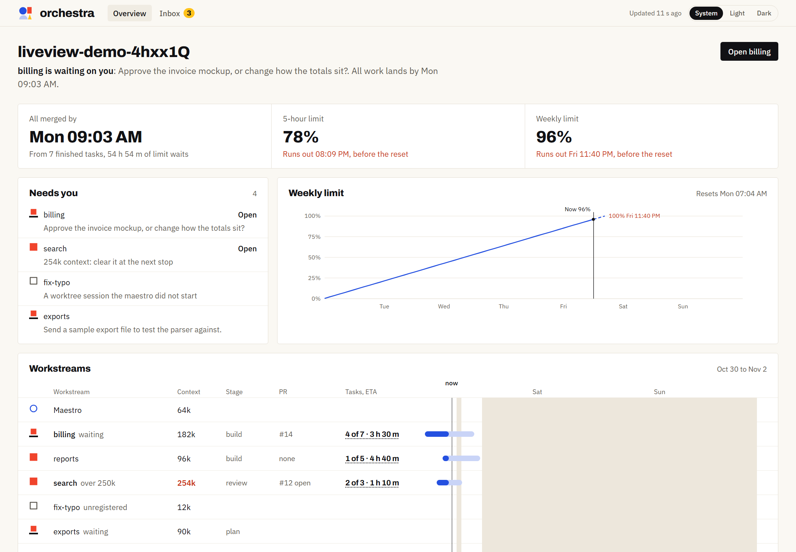
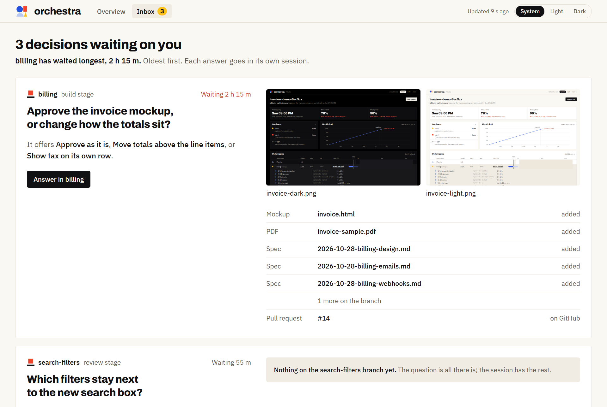

# The liveview

A local web page for the project: plan limits with a projection to the reset, what needs you, each workstream's progress, ETA and timeline, and an inbox of the questions waiting on you.

[README](../README.md) · [Setup](setup.md) · [Commands](commands.md) · [Agents](agents.md) · [Stages, modes and skills](stages.md) · [Memory and handoff](memory.md) · [The band](band.md) · **The liveview** · [Benchmarks](benchmarks.md)

  <picture>
    <source media="(prefers-color-scheme: dark)" srcset="../assets/readme/liveview-dark.png">
    
  </picture>

## Running it

The liveview is a plain Node process (Node 18 or newer) and uses no tokens.

- The [band](band.md) starts it when a maestro session opens and shows a `Liveview` button to open it.
- `/orchestra:liveview` starts it by hand and prints its address. `/orchestra:liveview stop` stops it.
- It stops on its own after 30 minutes with no session activity.
- It listens on `127.0.0.1` only, from port 4317, unless you open it to your Tailscale network (below).
- It refreshes every 5 seconds. For timings, see [Benchmarks](benchmarks.md).

## On your phone

A phone can't open your computer's `localhost`. With [Tailscale](https://tailscale.com) on both, the phone can open the liveview over your private Tailscale network. This is off unless you turn it on:

- **Always:** `/orchestra:settings tailscale on`. The band and `/orchestra:liveview` then start it this way. See [orchestra's settings](setup.md#orchestras-settings).
- **Once:** `/orchestra:liveview phone`.

The liveview then prints a second address, such as `http://my-pc.tail1234.ts.net:4317/`, to open on the phone.

Security limits:

- It listens on the computer's Tailscale address only, never on every network.
- It answers only devices signed in to your own Tailscale account. Other people's devices on the same Tailscale network get `forbidden`. A device you sign in later gets in within a minute.

Notes:

- Tailscale must be running when the liveview starts. If it isn't, the liveview runs on the computer only and says there is no phone address.
- A liveview already running without Tailscale stays that way: run `/orchestra:liveview stop`, then `/orchestra:liveview phone`.
- On Windows, the firewall may ask once whether Node can accept connections. Allow it for private networks.

## What it shows

- **Symbols**: each session uses the symbols in [`BRAND.md`](BRAND.md#symbols). The shape is the role, the way it is drawn is the state, and a context of 250k or more is a bold vermilion number.
- **Progress** comes from the plan checkboxes. The plan is the one the handoff note names (its `Plan:` line, another label such as `Plano:`, or the first plan path it mentions), else the one the branch adds. A plan split in parts (`x.md`, `x-part-2.md`) counts as one. When it finds none, the row says why: `no integration branch`, `2 plans added`, `no "### Task N:" headings`.
- **The integration branch** comes from `git config orchestra.protectedBranches`, which `/orchestra:init` sets, else from "Project settings" in `CLAUDE.md`.
- **ETAs** come from how long past tasks took, measured from the commits that ticked them. It uses past tasks with the same agent and risk, else the same agent, else all tasks: the first group with at least 3 finished. Until then it uses a default length, marked `?`.
- **The limit projection** reads token counts (never message content) from Claude Code's transcripts for every project on this computer, since plan limits are per account.
- **The band's run-out time**: while the liveview runs, it tells the band when the planned work will use up the week.

## The inbox

  <picture>
    <source media="(prefers-color-scheme: dark)" srcset="../assets/readme/inbox-dark.png">
    
  </picture>

The `Inbox` view lists every question a workstream is waiting on you to answer, oldest first, with the options it offers and the pictures, pages and docs on its branch. `Answer in` opens the session, where you answer. Chrome asks once before it opens a `claude://` link. A question left unanswered for a day leaves the inbox.
