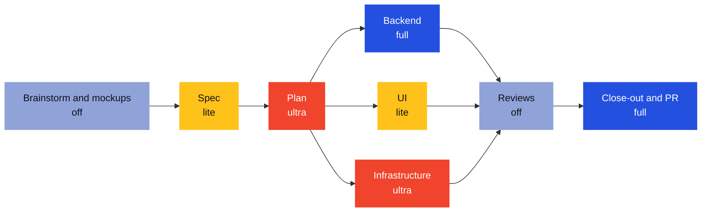

# Stages, modes and skills

Every workstream goes through the same stages, from brainstorm to PR. At each stage orchestra sets who does the work, which ponytail mode they use and which skills they load. The short version the sessions read is [`stages.md`](../plugins/orchestra/skills/maestro/stages.md) in the maestro skill.

[README](../README.md) · [Setup](setup.md) · [Commands](commands.md) · [Agents](agents.md) · **Stages, modes and skills** · [The band](band.md) · [The liveview](liveview.md) · [Benchmarks](benchmarks.md)

## The four modes

[ponytail](https://github.com/DietrichGebert/ponytail) makes an agent write the smallest change that fully solves the task. It has three levels, plus off:

| Mode | What it does | Used for |
| --- | --- | --- |
| **off** | No pressure to cut | Brainstorms, and reviews that must report everything |
| **lite** | Cuts bloat, keeps the polish | Specs, UI work, a mockup's fix round |
| **full** | The smallest complete change | Backend, mechanical work, searches, close-out; the default |
| **ultra** | Cuts hardest | Plans and infrastructure |

Every session starts in full and the maestro stays there. A principal switches its own mode at each stage and states the mode in every subagent briefing.

## The stages at a glance

| Stage | Who | Ponytail | Skills |
| --- | --- | --- | --- |
| [Brainstorm and mockups](#brainstorm-and-mockups) | Principal with the owner; a builder and a reviewer subagent | off; fix round lite | `superpowers:brainstorming`, one of `frontend-design`, `taste-skill` or `impeccable:impeccable`, the impeccable detector, `design:design-critique`, `design:ux-copy`, `dataviz` |
| [Spec](#spec) | Principal | lite | `security-audit` on sensitive specs |
| [Plan](#plan) | `planner` | ultra | `superpowers:writing-plans` |
| [Backend, database and integrations](#backend-database-and-integrations) | `implementer` or `implementer-advanced` | full | `superpowers:subagent-driven-development`, `superpowers:dispatching-parallel-agents`, `test-driven-development`, `verification-before-completion`, `systematic-debugging` |
| [UI implementation and polish](#ui-implementation-and-polish) | `implementer` | lite | `impeccable:impeccable`, `test-driven-development`, `verification-before-completion`, `dataviz` |
| [Infrastructure](#infrastructure) | `implementer-advanced` | ultra | as for backend |
| Mechanical work, at any stage | [`mechanic`](agents.md#mechanic) | full | none |
| Searches, at any stage | [`explorer`](agents.md#explorer) | full | none |
| [Reviews](#reviews) | `spec-reviewer`, `quality-reviewer`, `impeccable:impeccable-finish-reviewer` | off | `verification-before-completion`, `ponytail:ponytail-review`, `design:accessibility-review`, `design:ux-copy`, `superpowers:receiving-code-review` |
| [Close-out and PR](#close-out-and-pr) | Principal; `verifier` | full | `superpowers:requesting-code-review`, `ponytail:ponytail-debt`, `security-audit`, `superpowers:finishing-a-development-branch` |
| [Between releases](#between-releases) | Maestro | full | `ponytail:ponytail-audit`, the impeccable audit |

---

## Brainstorm and mockups

**Off**, because a brainstorm widens the options before picking one. A mode that pushes for the smallest answer would close it too early.

- `superpowers:brainstorming` runs the conversation: one question at a time, two or three approaches with a recommendation, and a design the owner approves before anything is built.
- One skill sets the visual direction: `frontend-design` by default, `taste-skill` for a page with no brand yet (it deals three directions from a library of real sites), or `impeccable:impeccable` for the strongest app screen at about twice the tokens. Never two: each plans a direction of its own, and stacked, the second throws the first away.
- The impeccable detector and `design:design-critique` check each mockup first, so the owner reviews the design, not its slips.
- `design:ux-copy` writes and checks the words: buttons that say what they do, empty states that say how to start, errors that say how to fix. The implementer copies the mockup's words, so this is where they are decided.
- `dataviz` designs the charts.

**The mockup recipe.** The principal doesn't draw mockups. It writes one brief (goal, the facts the page may state, brand traps, budget) and leaves the creative direction open. A builder subagent with one direction skill builds until a neutral inspection (wrapped headlines, tiny text, overflow, covered text, contrast) reports 0 FAIL. A separate reviewer subagent checks the screenshots with the detector and the critique and returns at most 8 findings and a score. The builder fixes only those, in lite, with at most 3 look rounds before the owner sees it. Once you approve a mockup, it is written down as impeccable's DESIGN.md, so the implementer and the finish reviewer check the build against it. Steps in the [mockup recipe](../plugins/orchestra/skills/maestro/stages.md#mockup-recipe).

**Why one direction skill.** In a blind comparison of design-skill setups on a landing page and an app screen, `frontend-design` followed by `taste-skill` made the weakest first builds (6.0 out of 10), below `frontend-design` alone (7.5) and impeccable alone (8.0). The review and fix round added 1.0 to 1.5 points for under 1M tokens. Each skill's own checker enforces its house style (taste-skill fails hairlines and monospace; impeccable flags fonts taste-skill deals), so the gate keeps only the checks that point at real defects.

**Redesign from scratch.** When you ask for screens as if built from scratch, specs that describe layouts would bring the current app back in a new skin. The recipe then swaps the specs for a list of each role's jobs and data, bans the current app's recognisable patterns, and gives each direction its own structural idea ("the plan as a timeline", "as a decision queue"). When you pick parts of several directions, the builder takes one as the base and carries the others' parts into it.

**Model and effort.** Agents don't inherit the session's effort. The principal sets model and effort on every agent orchestra doesn't define: max for setting a direction, reviews and UX fixes, high for building out an approved direction, low on Sonnet or Haiku for searches and screenshots. [The full map](../plugins/orchestra/skills/maestro/stages.md#model-and-effort).

## Spec

**Lite**, because the plan and the reviews check everything against the spec. Lite cuts padding but keeps every requirement; full could drop details a reviewer needs later.

`security-audit` runs early on sensitive specs (access, credentials, public pages, email), so security questions are answered before the plan, not found in review.

## Plan

**Ultra**, because the plan is where scope creep starts. It cuts whatever the spec does not ask for, never what it does. `superpowers:writing-plans` gives the format: self-contained tasks with an **Interfaces** block, complete code and exact commands. The [`planner`](agents.md#planner) tags each task with its agent and risk.

## Backend, database and integrations

**Full**, because in backend code extra lines become extra bugs. Full still keeps validation, error handling and security. `implementer` takes normal tasks, `implementer-advanced` takes security, migrations and integrations.

- The principal runs the plan with `superpowers:subagent-driven-development` (one fresh subagent per task, reviews between tasks) and `superpowers:dispatching-parallel-agents` for independent tasks.
- The subagent uses `test-driven-development` (see the test fail first), `verification-before-completion` (claim done only with real command output) and `systematic-debugging` (root cause before any change).

## UI implementation and polish

**Lite**, because UI quality lives in the states a mockup doesn't show: hover, focus, loading, empty, error, narrow screens. Full would cut them.

- `impeccable:impeccable` in Operate mode, with its craft floor read before any UI edit. The approved mockup and its DESIGN.md rule; impeccable fills in what they don't show.
- `test-driven-development` and `verification-before-completion`, as for backend, and `dataviz` for charts.

`frontend-design` and `taste-skill` are not used here: the direction is decided, and more art direction would drift from what the owner approved.

## Infrastructure

**Ultra**, because servers, CI, scripts and dependencies all have to be run, secured and kept up to date. The smallest working change is the safest, and every new dependency is a supply-chain risk. Skills as for backend.

## Reviews

**Off**, because a reviewer that tries to be brief drops findings. Reviewers ignore any injected mode and answer only in their review format.

The planner's risk tag picks the reviews:

| Risk | Reviews |
| --- | --- |
| `mechanical` (docs, renames, text) | [`spec-reviewer`](agents.md#spec-reviewer) only |
| `normal` | `spec-reviewer`, then [`quality-reviewer`](agents.md#quality-reviewer) |
| `sensitive` (money, access, credentials, database) | `spec-reviewer`, `quality-reviewer`, then `security-audit`, in sequence |
| `ui` | the reviews of its other risk, plus a finish review: [`screenshotter`](agents.md#screenshotter) captures, then `impeccable:impeccable-finish-reviewer` compares with the approved mockup, with `design:accessibility-review` and `design:ux-copy` |

Spec and quality reviews run in parallel only on low-risk tasks; on risky tasks they run in sequence, so the quality reviewer sees code that already matches the spec. The finish review needs a web UI with a dev server and browser checks; without them, `ui` tasks get only the reviews of their other risk. Before the PR, one more reviewer checks the whole branch (see [Close-out](#close-out-and-pr)).

Small changes stay light: a `ui` task that only adjusts an existing screen (spacing, colour, copy) gets `spec-reviewer` alone before the finish review, and screenshots cover only the widths and states it changes.

Skills: every reviewer uses `verification-before-completion` (run the command before asserting anything about it), and `quality-reviewer` uses the `ponytail:ponytail-review` method without the mode. The principal reads the findings with `superpowers:receiving-code-review`, checking each one before acting on it.

## Close-out and PR

**Full.**

- [`verifier`](agents.md#verifier) runs the full verification first, so the PR comes with real command output.
- `superpowers:requesting-code-review` sends one whole-branch reviewer using `ponytail:ponytail-review`, to catch problems that only show across tasks.
- `ponytail:ponytail-debt` lists every `shortcut:` comment in the PR description, so known limits are where the owner sees them.
- `security-audit` before a PR that touches access, credentials, public pages or email.
- `superpowers:finishing-a-development-branch` for the last steps.

## Between releases

**Full.** The maestro runs `ponytail:ponytail-audit` on the code and the impeccable audit on the screens. The findings become cleanup workstreams, each led by a principal. The maestro fixes nothing itself.

---

## Credits

orchestra only decides where each skill enters the flow. The skills, and the credit for them, belong to their authors.

| Plugin | Author | License | Where it enters |
| --- | --- | --- | --- |
| [superpowers](https://github.com/obra/superpowers) | Jesse Vincent (obra) | MIT | Brainstorm, plan, build (subagent-driven development, TDD, verification, debugging), reviews, close-out |
| [ponytail](https://github.com/DietrichGebert/ponytail) | Dietrich Gebert | MIT | The modes; `ponytail-review` in reviews and close-out; `ponytail-debt` in the PR; `ponytail-audit` between releases |
| [impeccable](https://github.com/pbakaus/impeccable) | Paul Bakaus | Apache-2.0 | A direction option and the detector on mockups; DESIGN.md from the approved mockup; Operate mode in UI work; the finish reviewer; the audit between releases |
| [taste-skill](https://github.com/Leonxlnx/taste-skill) | leonxlnx | MIT | Art direction for pages with no brand; its inspector as the mockups' check |
| [frontend-design](https://github.com/anthropics/claude-plugins-official/tree/main/plugins/frontend-design) | Anthropic | Apache-2.0 | The default visual direction for mockups |
| [design](https://github.com/anthropics/knowledge-work-plugins/tree/main/design) | Anthropic (knowledge-work plugins) | Apache-2.0 | `design-critique` and `ux-copy` on mockups; `accessibility-review` and `ux-copy` in the finish review |
| [security-audit](https://github.com/cloudflare/security-audit-skill) | Cloudflare | MIT | Sensitive specs, `sensitive` reviews, PRs that touch access, credentials, public pages or email |
| [playwright-cli](https://github.com/microsoft/playwright-cli) | Microsoft | Apache-2.0 | Browser checks and the screenshotter's captures |
| `dataviz` | Anthropic | ships with Claude Code | Charts in mockups and UI work |

Install them from the orchestra marketplace as [Setup](setup.md#install) shows. Each is fetched from its own repository and keeps its own license.
