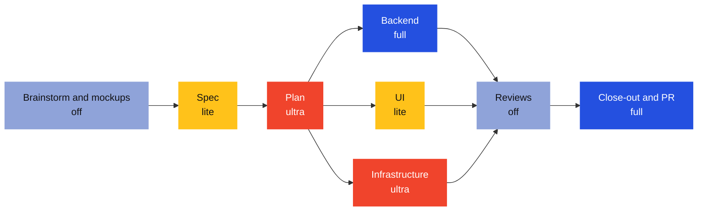

# Stages, modes and skills

A workstream moves through the same stages every time, from the brainstorm to the PR. At each stage orchestra decides three things: who does the work, which ponytail mode they work in, and which skills they load. This page explains each choice. The short table the sessions themselves read is [`stages.md`](../plugins/orchestra/skills/maestro/stages.md) in the maestro skill.

[README](../README.md) · [Agents](agents.md) · **Stages, modes and skills** · [The band](band.md)

## The four modes

[ponytail](https://github.com/DietrichGebert/ponytail) makes an agent write the smallest change that fully solves the task. It has three levels, plus off:

| Mode | What it does | Used for |
| --- | --- | --- |
| **off** | No pressure to cut | Exploring options, and reviews that must report everything |
| **lite** | Cuts bloat, keeps the polish | Specs, UI work, a mockup's fix round |
| **full** | The smallest complete change | Backend, mechanical work, searches, close-out; every session's default |
| **ultra** | Cuts hardest | Plans and infrastructure |

Every session starts in full. The maestro stays in full. A principal switches its own mode as it moves through the stages (`/ponytail lite`, `/ponytail ultra`, or "stop ponytail" for off) and states the mode in every subagent briefing. Each agent's file names its own mode too, so a subagent keeps the right one whatever the session's current level is.

ponytail's level is one flag for every session on the machine (`~/.claude/.ponytail-active`): switching it in one session switches all of them. That is why each agent's per-stage mode lives in its own prompt rather than in the flag.

## The stages at a glance

Mechanical work and searches run in full at any point. Between releases the maestro runs the audits, also in full.

| Stage | Who | Ponytail | Skills |
| --- | --- | --- | --- |
| [Brainstorm and mockups](#brainstorm-and-mockups) | Principal with the owner; a builder and a reviewer subagent | off; the fix round lite | `superpowers:brainstorming`, `frontend-design`, `taste-skill`, the impeccable detector, `design:design-critique`, `dataviz` |
| [Spec](#spec) | Principal | lite | `security-audit` on sensitive specs |
| [Plan](#plan) | `planner` | ultra | `superpowers:writing-plans` |
| [Backend, database and integrations](#backend-database-and-integrations) | `implementer` or `implementer-advanced` | full | `superpowers:subagent-driven-development`, `superpowers:dispatching-parallel-agents`, `test-driven-development`, `verification-before-completion`, `systematic-debugging` |
| [UI implementation and polish](#ui-implementation-and-polish) | `implementer` | lite | `impeccable:impeccable`, `test-driven-development`, `verification-before-completion`, `dataviz` |
| [Infrastructure](#infrastructure) | `implementer-advanced` | ultra | as for backend |
| [Mechanical work](#mechanical-work-and-searches) | `mechanic` | full | none |
| [Searches and summaries](#mechanical-work-and-searches) | `explorer` | full | none |
| [Reviews](#reviews) | `spec-reviewer`, `quality-reviewer`, `impeccable:impeccable-finish-reviewer` | off | `verification-before-completion`, `ponytail:ponytail-review`, `design:accessibility-review`, `superpowers:receiving-code-review` |
| [Close-out and PR](#close-out-and-pr) | Principal; `verifier` | full | `superpowers:requesting-code-review`, `ponytail:ponytail-debt`, `security-audit`, `superpowers:finishing-a-development-branch` |
| [Between releases](#between-releases) | Maestro | full | `ponytail:ponytail-audit`, the impeccable audit |

---

## Brainstorm and mockups

**Who:** the principal, with the owner. Mockups are drawn by a builder subagent and checked by a separate reviewer subagent.
**Mode:** off; the mockup's fix round in lite.

**Why off.** A brainstorm is for widening the options before picking one. A mode that pushes for the smallest answer would close it too early.

**Skills, and why:**

- `superpowers:brainstorming` runs the conversation: one question at a time, two or three approaches with a recommendation, and a design the owner approves before anything is built.
- `frontend-design` and `taste-skill` give the mockup a visual direction. `taste-skill` deals three directions, so the builder doesn't settle on the first idea. Both stay in the mockups and are not used when the UI is built.
- The **impeccable detector** and `design:design-critique` check a mockup before the owner sees it, so the owner reviews a design and not its slips.
- `dataviz` designs the charts.

**The mockup recipe.** The principal doesn't draw mockups itself. It writes one brief (the goal, the facts the page may state, the brand traps and a budget) and keeps the creative direction open. A builder subagent builds until its inspection reports 0 FAIL. A separate reviewer subagent looks at the screenshots, runs the detector and the critique, and returns at most 8 findings and a score. The builder never sees the reviewer's screenshots. The builder then fixes only those findings in lite, with at most 3 look rounds before the owner sees the result. In a blind test this scored within 0.4 of a max-effort build (7.3 and 7.4 against 7.7 out of 10), with better accuracy, for about a third of the tokens. The steps are in [`stages.md`](../plugins/orchestra/skills/maestro/stages.md#mockup-recipe).

## Spec

**Who:** the principal. **Mode:** lite.

**Why lite.** A spec must be complete: everything the plan and the reviews will check comes from it. Lite cuts padding and keeps every requirement. Full could drop the details a reviewer later needs.

**Skills:** `security-audit` early on sensitive specs (access, credentials, public pages, email), so the security questions are answered before the plan, not found in review.

## Plan

**Who:** `planner` (Opus, high). **Mode:** ultra.

**Why ultra.** The plan is where scope creep starts. Ultra cuts from the plan whatever the spec does not ask for, and never what it does. Every task a plan leaves out is a task nobody builds, reviews or maintains.

**Skills:** `superpowers:writing-plans`, for its format: global constraints, file structure, and self-contained tasks with an **Interfaces** block, complete code and exact commands. The planner also tags each task with its agent and its risk, which picks the reviews later.

## Backend, database and integrations

**Who:** `implementer` (Sonnet, medium) for normal tasks, `implementer-advanced` (Opus, high) for security, migrations and integrations. **Mode:** full.

**Why full.** Backend code is where extra lines turn into extra bugs. Full writes the smallest change that fully works, and still keeps validation, error handling and security.

**Skills, and why:**

- The principal uses `superpowers:subagent-driven-development` to run the plan one task per fresh subagent, with reviews between tasks, and `superpowers:dispatching-parallel-agents` when tasks are independent.
- The subagent uses `test-driven-development` (see the test fail before implementing), `verification-before-completion` (claim done only with the real command and its output) and `systematic-debugging` (find the root cause before changing anything).

## UI implementation and polish

**Who:** `implementer`. **Mode:** lite.

**Why lite.** UI quality lives in the states a mockup doesn't show: hover, focus, loading, empty, error and narrow screens. Full mode would cut them. Lite keeps them and still drops bloat.

**Skills, and why:**

- `impeccable:impeccable` in Operate mode, with its craft floor read before any UI edit. The approved mockup rules; impeccable decides what the mockup doesn't show.
- `test-driven-development` and `verification-before-completion`, as for backend.
- `dataviz` for charts.

`frontend-design` and `taste-skill` stay in the mockups: by now the direction is decided, and a second pass of art direction would drift from what the owner approved.

## Infrastructure

**Who:** `implementer-advanced`. **Mode:** ultra.

**Why ultra.** Servers, CI, scripts and dependencies are code that has to be run, secured and kept up to date. The smallest working change is the safest one, and every new dependency is a supply-chain risk.

**Skills:** as for backend.

## Mechanical work and searches

**Who:** `mechanic` (docs, renames, formatting) and `explorer` (searches and summaries), both Haiku at low effort. **Mode:** full. **Skills:** none.

These jobs have no decisions to make, so they need no skills: `mechanic` does exactly what the prompt says and `explorer` answers exactly what was asked.

## Reviews

**Who:** `spec-reviewer` (Sonnet), `quality-reviewer` (Opus), and for UI tasks `impeccable:impeccable-finish-reviewer`. **Mode:** off.

**Why off.** A reviewer that tries to be brief drops findings. Reviewers ignore any injected mode and answer only in their review format.

**Skills, and why:**

- `verification-before-completion`: a reviewer runs the command before asserting anything about it.
- `quality-reviewer` uses the `ponytail:ponytail-review` method (correct, secure, holds under load, tested, fast, every line earns its place), without the mode itself.
- `design:accessibility-review` with the third UI review.
- The principal uses `superpowers:receiving-code-review` on the findings, to check each one before acting on it rather than agreeing with all of them.

**Risk-proportional review.** The planner's risk tag picks the reviews:

| Risk | Reviews |
| --- | --- |
| `mechanical` (docs, renames, text) | `spec-reviewer` only |
| `normal` | `spec-reviewer`, then `quality-reviewer` |
| `sensitive` (money, access, credentials, database) | `spec-reviewer`, `quality-reviewer`, then `security-audit`, in sequence |
| `ui` | the reviews of its other risk, plus a third: `screenshotter` captures, then `impeccable:impeccable-finish-reviewer` against the approved mockup, with `design:accessibility-review` |

Spec and quality reviews run in parallel only on low-risk tasks. On risky tasks they run in sequence, so the quality reviewer sees code that already matches the spec. The third UI review needs a web UI with a dev server and browser checks; without them, `ui` tasks get only the reviews of their other risk.

## Close-out and PR

**Who:** the principal, with `verifier` (Sonnet, low). **Mode:** full.

**Skills, and why:**

- `verifier` runs the full verification first, so the PR comes with real command output.
- `superpowers:requesting-code-review` dispatches one whole-branch reviewer using `ponytail:ponytail-review`. Per-task reviews can miss problems that only show across tasks.
- `ponytail:ponytail-debt` lists every `shortcut:` comment for the PR description, so known limits are written down where the owner sees them.
- `security-audit` before a PR that touches access, credentials, public pages or email.
- `superpowers:finishing-a-development-branch` for the last steps.

## Between releases

**Who:** the maestro. **Mode:** full.

**Skills:** `ponytail:ponytail-audit` on the code and the impeccable audit on the screens. Their findings become cleanup workstreams, each led by a principal like any other. The maestro itself never fixes anything.

---

## Credits

orchestra only decides where each of these skills enters the flow. The skills themselves, and all the credit for them, belong to their authors.

| Plugin | Author | License | Where it enters |
| --- | --- | --- | --- |
| [superpowers](https://github.com/obra/superpowers) | Jesse Vincent (obra) | MIT | Brainstorm, plan, backend and UI (subagent-driven development, TDD, verification, debugging), reviews (receiving code review), close-out (requesting code review, finishing a branch) |
| [ponytail](https://github.com/DietrichGebert/ponytail) | Dietrich Gebert | MIT | The modes at every stage; `ponytail-review` in the quality review and close-out; `ponytail-debt` in the PR; `ponytail-audit` between releases |
| [impeccable](https://github.com/pbakaus/impeccable) | Paul Bakaus | Apache-2.0 | The detector on mockups; Operate mode in UI work; the finish reviewer in the third UI review; the audit between releases |
| [taste-skill](https://github.com/Leonxlnx/taste-skill) | leonxlnx | MIT | Art direction for mockups |
| [frontend-design](https://github.com/anthropics/claude-plugins-official/tree/main/plugins/frontend-design) | Anthropic | Apache-2.0 | Visual direction for mockups |
| [design](https://github.com/anthropics/knowledge-work-plugins/tree/main/design) | Anthropic (knowledge-work plugins) | Apache-2.0 | `design-critique` on mockups; `accessibility-review` in the third UI review |
| [security-audit](https://github.com/cloudflare/security-audit-skill) | Cloudflare | MIT | Sensitive specs, `sensitive` reviews, and before PRs that touch access, credentials, public pages or email |
| [playwright-cli](https://github.com/microsoft/playwright-cli) | Microsoft | Apache-2.0 | Browser checks by the implementers and reviewers, and the screenshotter's captures |
| `dataviz` | Anthropic | ships with Claude Code | Charts in mockups and UI work |

Install them from the orchestra marketplace as the [README](../README.md#install) shows. Each one is fetched from its own repository and keeps its own license.
